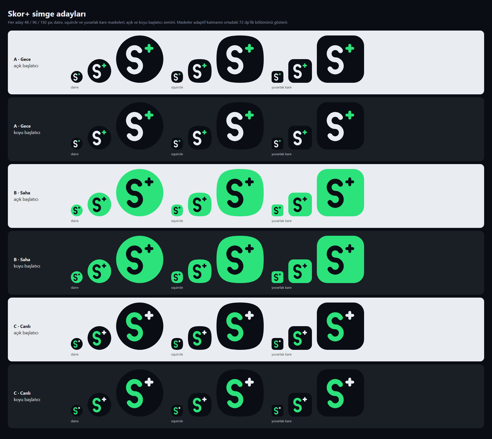

# Skor+ uygulama simgesi: adaylar

Hazırlayan: UI/UX tasarım ajanı · 19 Kasım 2026. Durum: **A · Gece onaylandı** (pazarlama + reklam, 19 Kasım 2026); `assets/` klasörüne kopyalandı (ana oturum). Öne çıkan grafik F1–F5 düzeltmesi bekliyor.



## Adaylar

Üç aday da aynı işareti kullanır: geometrik, kalın bir **"S"** ve sağ üstünde **"+"**. Uygulama başlığındaki "Skor+" yazısının kısaltmasıdır. Top, forma, pota, saha, kulüp ya da lig işareti yoktur.

| Aday | Zemin | S | + | Karakter |
|---|---|---|---|---|
| **A · Gece** | `#0A0E14` (`bg`) | `#E8EDF3` (`text`) | `#2BE37A` (`live`) | Uygulamanın kendisi: koyu arayüz, beyaz "Skor", yeşil "+". Sakin, okunur. |
| **B · Saha** | `#2BE37A` (`live`) | `#0A0E14` | `#0A0E14` | Mağazada en parlak seçenek. Yeşil karo. |
| **C · Canlı** | `#0A0E14` | `#2BE37A` | `#E8EDF3` | Yeşil ana renk; "+" ikinci planda. |

Kontrast: A'da S/zemin 16.4:1, +/zemin 11.4:1. B'de S/zemin 11.4:1. C'de S/zemin 11.4:1, +/zemin 16.4:1.

## Öneri: **A · Gece**

1. **Marka tutarlılığı.** Uygulamayı açan kişi aynı "Skor+" yazısını (beyaz Skor, yeşil +) başlıkta görür. Simge ile uygulama aynı dili konuşur. Mağaza grafiğiyle de aynı.
2. **Renk anlamını korur.** Rehberin 3. ilkesi: yeşil = canlı/olumlu. A'da yeşil yalnız "+"da, tıpkı arayüzde olduğu gibi. B'de yeşil koca bir zemin olur ve "canlı" anlamını taşımaz. C'de yeşil S, "+"yı ikinci plana iter.
3. **Küçük boyutta okunurluk.** 48 px'te "S" beyaz ve kalın, "+" ayrı bir yeşil leke olarak seçiliyor (bkz. `preview.png`). Beyaz–koyu kontrastı (16.4:1) üç aday içinde en yüksek.
4. **Benzerlik riski düşük.** Parlak yeşil tam karo (B), ana ekranda çok yaygın yeşil simgeli uygulamaların arasında kaybolabilir. Koyu karo üstünde beyaz harf, açık duvar kâğıdında belirgin.
5. **Zayıf yön ve önlemi.** Koyu başlatıcı zemininde (`#1A1F26`) koyu karonun kenarı belirsizleşiyor; işaretin kendisi yine net. Gerekirse arka plan katmanına çok hafif bir üst ışık eklenebilir (`#121821` → `#0A0E14` dikey geçiş). Bu sürümde düz renk bırakıldı; Play simgesinde degrade gereksiz.

İkinci tercih: **C** (yeşil ağırlıklı bir kimlik istenirse).

## Geometri ve güvenli alan

- **S:** İki çemberin (r = 55, merkezler 110 birim aralıklı) yaylarından oluşan merkez çizgisi, çizgi kalınlığı 44, yuvarlak uçlar. Yazı tipine bağlı değil, her ortamda aynı çıkar. SVG yolu: `M147.6 67.5 A55 55 0 1 0 100 150 A55 55 0 1 1 52.4 232.5`.
- **+:** Kol 80, kalınlık 26, yuvarlak uçlar. 48 px'te görünmesi için S'ye göre büyük tutuldu.
- **Adaptif simge (1024 px = 108 dp):**
  - İşaret yüksekliği 440 px.
  - En uzak noktanın merkezden uzaklığı ≈ 296 px. Android güvenli alanı 66 dp, yani 1024 tuvalde çapı 626 px (r = 313 px); işaret bu dairenin içinde kalıyor.
  - Başlatıcı maskeleri ortadaki 72 dp'yi (r = 341 px) gösterir; daire maskesinde bile "+" kırpılmıyor (`preview.png`).
- **Play simgesi / `icon.png`:**
  - Tam dolu kare zemin, işaret yüksekliği tuvalin %50'si.
  - Play'in uyguladığı %30 köşe yarıçapından sonra da işaret köşelere yaklaşmıyor.
  - İşaret keyline dairesinin içinde.
- **Favicon (48 px):** Çizgiler %10 kalın, işaret tuvalin %62'si.

## Play gereksinimleriyle karşılaştırma

Kaynaklar:
- [Play Console Help: Add preview assets](https://support.google.com/googleplay/android-developer/answer/9866151?hl=en)
- [Google Play icon design specifications](https://developer.android.com/distribute/google-play/resources/icon-design-specifications)

| Gereksinim | Değer | A / B / C |
|---|---|---|
| Play simgesi biçimi | 32-bit PNG (alfa kanallı) | `play-icon-512.png`: renk türü 6 (RGBA) ✓ |
| Play simgesi ölçüsü | 512×512 px | ✓ |
| Play simgesi dosya boyutu | ≤ 1024 KB | 8 KB ✓ |
| Rozet / sıralama / fiyat metni yok | – | ✓ (yalnız "S+") |
| Gölge eklenmez (Play ekler) | – | ✓ |
| Köşe yuvarlatılmaz (Play %30 uygular) | – | ✓ tam kare |
| Saydam zemin önerilmez | – | ✓ zemin tam opak (alfa 255) |
| Öne çıkan grafik | 1024×500, JPEG veya 24-bit PNG (alfa yok) | `feature-graphic.png`: renk türü 2 (RGB) ✓, `feature-graphic.jpg` ✓ |
| Lig / kulüp / oyuncu görseli yok | – | ✓ |

Öne çıkan grafikteki analiz kartı uygulama arayüzünün temsilî bir çizimidir; takım adı içermez ve kartta "Temsilî örnek" yazar.

## Dosyalar

Her aday klasöründe (`A/`, `B/`, `C/`) aynı set var. SVG'ler kaynaktır; PNG'ler `render.mjs` ile üretildi.

| Dosya | Ölçü | Tür | Kullanım |
|---|---|---|---|
| `icon.svg` / `icon.png` | 1024×1024 | RGB, opak | Expo `icon` |
| `play-icon-512.png` | 512×512 | RGBA (32-bit) | Play Console → Uygulama simgesi |
| `adaptive-foreground.svg` / `.png` | 1024×1024 | RGBA, saydam zemin | Android adaptif ön katman |
| `adaptive-background.svg` / `.png` | 1024×1024 | RGB, düz renk | Android adaptif arka katman |
| `adaptive-monochrome.svg` / `.png` | 1024×1024 | RGBA, beyaz işaret | Android 13+ temalı simge |
| `splash-icon.svg` / `.png` | 1024×1024 | RGBA, saydam zemin | Açılış ekranı işareti (zemin `#0A0E14`) |
| `favicon.svg` / `.png` | 48×48 | RGB | Web favicon |

Ortak dosyalar:
- `preview.png`: 3 aday × 48/96/192 px × daire/squircle/yuvarlak kare × açık/koyu başlatıcı.
- `feature-graphic.png` (1024×500, RGB) ve `feature-graphic.jpg`: önerilen A işaretiyle mağaza öne çıkan grafiği. `feature-graphic.html` kaynağıdır.
- `render.mjs`: üretim betiği. Yeniden üretmek için proje kökünden:
  ```
  PLAYWRIGHT_BROWSERS_PATH=<chromium klasörü> node store/icon/render.mjs
  ```

## Onaydan sonra `assets/` kopya planı (seçilen aday `X` için)

| Kaynak | Hedef | Not |
|---|---|---|
| `store/icon/X/icon.png` | `assets/icon.png` | üzerine yazılır |
| `store/icon/X/adaptive-foreground.png` | `assets/android-icon-foreground.png` | üzerine yazılır |
| `store/icon/X/adaptive-background.png` | `assets/android-icon-background.png` | üzerine yazılır (eski kılavuz ızgarası gider) |
| `store/icon/X/adaptive-monochrome.png` | `assets/android-icon-monochrome.png` | üzerine yazılır (432 → 1024 px) |
| `store/icon/X/splash-icon.png` | `assets/splash-icon.png` | üzerine yazılır |
| `store/icon/X/favicon.png` | `assets/favicon.png` | üzerine yazılır |
| `store/icon/X/play-icon-512.png` | Play Console'a yüklenir | `assets/`'e girmez |
| `store/icon/feature-graphic.png` | Play Console'a yüklenir | `assets/`'e girmez. B veya C seçilirse `render.mjs` içindeki `REC` değeri değiştirilip yeniden üretilir. |

`app.json` değişikliği:
- `android.adaptiveIcon.backgroundColor` zaten `#0A0E14`, A ve C için doğru. B seçilirse `#2BE37A` olur.
- Bugün `expo-splash-screen` eklentisi yapılandırılmamış, bu yüzden `splash-icon.png` kullanılmıyor. İsteğe bağlı olarak `plugins` içine şu eklenir:
  ```json
  ["expo-splash-screen", { "image": "./assets/splash-icon.png", "imageWidth": 200, "backgroundColor": "#0A0E14" }]
  ```
  Bu, paketin kurulmasını ve SDK 58 belgesine göre doğrulanmasını gerektirir (bkz. `AGENTS.md`).
- İsteğe bağlı: `expo-notifications` eklentisine `icon` olarak tek renk beyaz işaret (96×96, `adaptive-monochrome.png`'den küçültülür) verilirse, Android bildirim çubuğundaki simge Expo varsayılanı yerine Skor+ olur.

## Önemli: simge değişikliği yeni native build gerektirir

- Uygulama simgesi, adaptif katmanlar ve açılış ekranı **native** kaynaklardır. `npm run update:apk` (OTA) ile **gelmez**.
- Yeni APK gerekir: `npm run build:apk` (EAS build). Kullanıcılar yeni APK'yı kurana kadar eski (Expo şablonu) simgeyi görür.
- `app.json` `runtimeVersion.policy = "appVersion"`. Native değişiklikle birlikte `version` artırılmalı (ör. 1.0.0 → 1.1.0). Böylece yeni build yeni OTA kanalı sürümüne bağlanır ve eski APK'lara uyumsuz güncelleme gitmez.
- Favicon yalnız web içindir; web dışa aktarımıyla gelir.

## İnceleme için açık sorular (pazarlama / reklam)

1. A, B veya C? Öneri A.
2. "S" biçimi (geometrik, yuvarlak uçlu) marka sesine uyuyor mu, yoksa daha keskin, köşeli bir S mi isteniyor?
3. Öne çıkan grafikteki temsilî analiz kartı metni ("Maç 64. dakikada tek geçişle koptu") pazarlama §8 kurallarına uygun mu? Kartta "Temsilî örnek" etiketi var.

## İkon onayı (pazarlama)

Hazırlayan: pazarlama ajanı · 19 Kasım 2026. Dayanak: `docs/pazarlama-stratejisi.md` Sürüm 3 (§3 ASO, §4 Play politika korkulukları, §11 yasaklı ifadeler ve görsel kurallar). İncelenen dosyalar: `preview.png`, `A/play-icon-512.png`, `feature-graphic.png`.

**Karar: DEĞİŞİKLİK.** Simge **A · Gece** olduğu gibi onaylandı. Öne çıkan grafik, aşağıdaki iki zorunlu değişiklikten sonra onaylanır.

### 1. Simge: A · Gece (onay)
- **Marka tutarlılığı:** Beyaz "S" + yeşil "+", uygulama başlığındaki "Skor+" yazısının birebir kısaltması. Mağaza adı (`Skor+ Canlı Skor ve AI Analiz`), simge ve öne çıkan grafik aynı dili konuşur. ASO açısından en güçlü seçenek budur: kullanıcı aramada gördüğü işareti uygulamada ve bildirimde tekrar görür.
- **48 px okunurluk:** `preview.png`'de 48 px'te üç maske türünde ve iki başlatıcı zemininde "S" net, "+" ayrı bir yeşil nokta olarak seçiliyor. B'de 48 px'te koyu "+" S'ye yapışıyor ve kayboluyor; C'de beyaz "+" küçük kalıyor ve S ile + arasındaki renk hiyerarşisi markanın tersine dönüyor (yeşil "Skor", beyaz "+").
- **Rakipler arasında ayrışma:** Spor kategorisindeki skor uygulamalarının çoğu marka renginde dolu karo veya logo kullanıyor. Koyu karo üstünde tek beyaz harf ve tek yeşil vurgu, Play'in açık temalı arama listesinde yüksek kontrastlı bir "delik" gibi durur. B'nin parlak yeşil karosu ise yeşil tonlu spor simgeleri arasında kaybolma riski taşır. ⚠ Rakiplerin güncel simge renkleri bu incelemede görsel olarak doğrulanmadı. Yükleme öncesi öneri (zorunlu değil): Play'de "canlı skor" aramasının ekran görüntüsüne A'yı 48 px olarak yerleştirip yan yana bakmak.
- **Politika:** Simgede rozet, sıralama, fiyat, "ücretsiz", kulüp/lig/NBA işareti, top veya forma yok. Play meta veri ve fikrî mülkiyet kurallarına uygun.
- **"S" biçimi (açık soru 2):** Geometrik, yuvarlak uçlu S stratejideki "sakin, zeki, akıllı arkadaş" tonuna uyuyor. Köşeli bir S istenmiyor.
- **Bilinen zayıflık:** Koyu Play temasında ve koyu başlatıcıda karonun kenarı kaybolur, işaret yine net. Düz renk kalabilir. Tasarımcının önerdiği hafif dikey geçiş isteğe bağlıdır, onay şartı değildir.

### 2. Öne çıkan grafik: metin kontrolü
| Öğe | Durum | Gerekçe |
|---|---|---|
| "Skor+" ve "Skoru herkes görür, nedenini sen gör." | ✓ | Onaylı tagline; üstünlük veya hız iddiası yok. |
| "Futbol · NBA · Türkçe AI" | ✓ | Kapsam doğru. Hız, "canlı" ve "ücretsiz" iddiası yok. |
| Kart başlığı "Maç 64. dakikada tek geçişle koptu" | ✓ (dil) | Maç sonu analizi dili. Tahmin, bahis, "kesin" yok. xG 0.62–1.38 ve top %71–%29 tutarlı bir "kısır top hakimiyeti" hikâyesi anlatıyor. Takım adı ve logo yok. |
| Rozet "✦ AI MAÇ ANALİZİ" | ✗ **değişmeli** | Kart bir Pro özelliğini gösteriyor ama "Pro" işareti yok. Strateji §3.5 ve §11: Pro ekranlarında "Pro" rozeti zorunlu. Mağazanın en görünür görselinde ücretli özelliği işaretsiz göstermek "ücretsiz" sanılmasına yol açar (yanıltıcı meta veri riski). |
| "Temsilî örnek" | ✗ **değişmeli** | Etiket var, ama küçük ve düşük kontrastlı gri; telefonda Play'in küçülttüğü grafikte okunmaz. Ayrıca strateji §11, AI örneklerinde "AI tarafından üretildi" etiketi istiyor. |
| Logo, oyuncu, maç görüntüsü | ✓ | Yok. |

Temsilî kart hakkında: Sürüm 2 kuralı "AI örnekleri gerçek maçlardan gelir, kurgu yok" diyordu. Bu kart bir ekran görüntüsü değil, arayüzün çizimidir. Takım adı içermediği ve okunur biçimde "Temsilî örnek" dendiği sürece kabul edilir. Daha iyisi (zorunlu değil): kontrol edilmiş gerçek bir maç sonu raporunun başlığını ve değerlerini takım adları olmadan kullanmak. O zaman etiket "Gerçek maçtan, takım adları gizlendi" olur.

### 3. Zorunlu değişiklikler (yalnız öne çıkan grafik)
1. **Rozet:** `✦ AI MAÇ ANALİZİ` → `✦ PRO · AI MAÇ ANALİZİ` (veya kartın sağ üstünde ayrı, okunur bir "PRO" etiketi).
2. **Alt etiket:** `Temsilî örnek` → `AI tarafından üretildi · Temsilî örnek`. Kontrast ≥ 4.5:1 olmalı (ör. `#9AA4B2` yerine `#C9D1DB` tonu) ve 1024×500'de en az ~18 px yazı boyutu.

Bu iki değişiklik `feature-graphic.html` içinde yapılır, `render.mjs` ile `feature-graphic.png/.jpg` yeniden üretilir. Simge dosyalarında değişiklik yok.

Not: Simge native bir kaynak olduğu için Play sürümünün ilk build'ine girmeli (OTA ile gelmez). Play kapalı test build'inden önce `assets/` kopyası yapılırsa test ekibi ve mağaza aynı simgeyi görür.

## İkon onayı (reklam)

Hazırlayan: reklam ajanı · 19 Kasım 2026. İncelenen dosyalar: `preview.png`, `A/play-icon-512.png`, `feature-graphic.png`. Ölçüt: Google App Campaigns (UAC) otomatik reklamları, kısa video kapanış kartları, QR afişleri (`docs/reklam-fikirleri.md` §7.2, §9).

**Karar: Simge için ONAY → A · Gece. Öne çıkan grafiğin reklamda kullanılması için DEĞİŞİKLİK gerekli** (aşağıda F1–F5). Play mağaza sayfasında F1 ve F2 yapıldıktan sonra kullanılabilir.

### 1. Adayların reklam ortamında değerlendirmesi

| Ortam | A · Gece | B · Saha | C · Canlı |
|---|---|---|---|
| UAC: Play, Arama ve YouTube'daki küçük simge (~48 px) | "S" net ve "+" ayrı yeşil leke olarak seçiliyor. En okunur aday. | Okunur. Ama Play'in yeşil "Yükle" düğmesinin hemen yanında düğmeyle aynı renk alanına karışıyor. | Okunur. "+" beyaz ve küçük olduğu için 48 px'te "S" tek başına kalıyor; "Skor+" çağrışımı zayıflıyor. |
| Açık akış (beyaz Play, Discover, açık Instagram) | Çok iyi. Koyu karo belirgin. | İyi ama yaygın yeşil simgeler arasında ayırt edilmesi zor. | İyi. |
| Koyu akış (YouTube koyu tema, TikTok, Reels) | Karonun kenarı kayboluyor (preview.png koyu satır). İşaret yine net. Önlem gerekiyor (aşağıda K1). | En iyi: parlak karo her zeminde görünür. | A ile aynı kenar sorunu. |
| Video kapanış kartı (koyu zemin `#0A0E14`) | Kenar tamamen kaybolur; işaret "S+" yazısı gibi okunur. Bu da sorun değil, çünkü kapanış kartındaki "Skor+" yazısıyla aynı dil. | Kartta tek parlak blok olur, metni bastırır. | Yeşil S, Pro/AI rozetlerinin sarı-yeşil vurgularıyla yarışır. |
| QR afişi (A5, beyaz kâğıt, siyah-beyaz baskı riski) | Gri tonlamada S ve karo kontrastı korunur. "+" koyu griye döner ama seçilir. | Gri tonlamada yeşil zemin orta gri olur, siyah S ile kontrast düşer. | Gri tonlamada yeşil S orta gri olur, kontrast düşer. |
| Renk anlamı (yeşil = canlı/olumlu) | Korunuyor. | Bozuluyor. | Kısmen bozuluyor. |

**Seçim: A.** Gerekçe: küçük boyutta en okunur, gri tonlamada en dayanıklı, uygulama ve kapanış kartıyla aynı dil. Play'in yeşil düğmesiyle de karışmıyor. Tek zayıflığı koyu akıştaki kenar kaybı. Bu, simgeyi değiştirmeden reklam kullanım kuralıyla çözülür:

- **K1 (yalnız reklam varlıkları, Play simgesi değişmez):** Koyu zeminli kreatiflerde (video kapanış kartı, koyu UAC görseli, koyu Telegram/WhatsApp görseli) simge, 2 px `#2A3340` kenarlı veya `#121821` zeminli bir yuvarlak karo içine konur. Play simgesine kenar eklenmez; Play kendi gölgesini ekler.
- **K2:** QR afişinde simge QR kodun **içine** konmaz (logolu QR okuma hatasını artırır). Simge QR'ın yanında durur. QR'ın etrafında en az 4 modül genişliğinde beyaz boşluk bırakılır.
- **K3:** Tasarımcının önerdiği hafif üst ışık (`#121821` → `#0A0E14`) yalnız adaptif arka katmanda isteğe bağlıdır. Reklam açısından şart değildir.
- Açık soru 2 ("S" biçimi): Yuvarlak uçlu geometrik S, "sakin, zeki" marka sesine uyuyor. Köşeli S gerekmez.

### 2. Öne çıkan grafik: UAC varlığı olarak

Mağaza öne çıkan grafiği olarak yapı doğru: tek mesaj, logo ve kulüp görseli yok, "Temsilî örnek" etiketi var. Reklam varlığı olarak beş sorun var:

| # | Sorun | Değişiklik |
|---|---|---|
| F1 | **Uydurma analiz rakamları.** Kartta "Maç 64. dakikada tek geçişle koptu", xG 0.62–1.38 ve %71–%29 var. Bunlar gerçek bir maçtan değil. Reklam kuralı (§7.2, §9.0): AI örnekleri gerçek maçtan alınır. "Temsilî örnek" etiketi bunu mağaza için bile zayıf karşılıyor. Reklamda kesinlikle yetmez. | İki seçenek. (a) Gerçek ve kontrol edilmiş bir AI raporundan başlık ve iki çubuk; takım adı yok, kartta "AI tarafından üretildi". (b) Rakamsız soyut kart: başlık "Maç hangi anda koptu?", çubuklar etiketsiz ve değersiz. Etiket aynen "Temsilî örnek". Reklam varlığında (a) tercih edilir. |
| F2 | **"Temsilî örnek" etiketi okunmuyor.** Yaklaşık 12 px, gri, düşük kontrastlı. 1024 px'te zor, UAC küçültmesinde görünmez. AI kartında "AI tarafından üretildi" ve "Pro" rozeti de yok (strateji §3.5, §4.2). | Etiket en az 18 px (1024 genişlikte), `#C9D1DB` veya daha açık renk. Rozet satırı: "✦ AI MAÇ ANALİZİ · PRO". Altına "AI tarafından üretildi" (F1a seçilirse) veya "Temsilî örnek" (F1b seçilirse). |
| F3 | **Oran ve güvenli alan.** Grafik 1024×500 (≈2,05:1). UAC yatay görseli 1,91:1 ister; kare ve dikey görseller de önerilir ⚠ (Google Ads görsel ölçüleri doğrulanmalı). 1,91:1 kırpmada iki yandan ~35 px gider. Kartın sağ kenarı (~x 985) kırpılır. Kare kırpmada başlık ikiye bölünür. | Feature graphic UAC'ye **doğrudan verilmez**. Aynı öğelerle ayrı varlıklar üretilir: 1200×628, 1200×1200 ve 1200×1500 ⚠. Tüm metin ve kart, kenarlardan en az %8 içeride tutulur. Mağaza sürümünde de kart 40 px sola çekilir. Merkezde, Play'in video oynatma düğmesinin binebileceği alana metin konmaz (tanıtım videosu eklenirse). |
| F4 | **Metin yoğunluğu.** Wordmark, iki satır slogan, alt satır, kart başlığı, iki çubuk etiketi ve dört sayı var. Görselin üçte birinden fazlası metin. UAC küçük yerleşimlerde (Display, Discover) okunmaz. Google çok metinli görselleri düşük performanslı sayar ⚠. | UAC görselinde metin iki öğeyle sınırlanır: "Skor+" wordmark ve "Skoru herkes görür, nedenini sen gör." Kart başlığı en fazla 1 satır; çubuklarda sayı yok. Alt satır kaldırılır. Uzun mesaj UAC'nin başlık/açıklama metinlerine taşınır (§9.4). |
| F5 | **"NBA" görsel metinde.** Reklam kuralı §7.2: ücretli kreatiflerde lig adı yalnız gövde metninde, betimleyici olarak geçer. | Mağaza grafiğinde "Futbol · NBA · Türkçe AI" kalabilir (tanımlayıcı, ASO §3.4 ⚠). UAC görsel varyantında "Futbol · Basketbol · Türkçe AI" yazılır ya da satır kaldırılır (F4). |

Diğer kontroller (geçti): Bahis/tahmin dili yok. "Koptu" bir analiz anlatımıdır, tahmin değildir. Kulüp ve lig logosu yok, oyuncu yok. Renkler A simgesiyle aynı. Koyu zemin, açık ve koyu akışta kendi kenarını taşıyan sarı çerçeveli kartla ayrışıyor.

### 3. Sonuç

- **ONAY: A · Gece** simge olarak (Play simgesi, adaptif katmanlar, favicon). Reklam kullanımında K1 ve K2 kuralları geçerlidir.
- **DEĞİŞİKLİK: `feature-graphic`.**
  - Mağaza için önce F1 ve F2 yapılır (ve F3'teki kart kaydırması).
  - UAC için F1–F5'e göre ayrı 1,91:1, 1:1 ve 4:5 varlıkları üretilir.
  - Mevcut dosya UAC'ye yüklenmez.
  - UAC, mağaza grafiğini kendiliğinden kullanabilir ⚠. Bu yüzden kampanyada kendi görsellerimiz yüklenir.

## Öne çıkan grafik v2

Hazırlayan: UI/UX tasarım ajanı · 19 Kasım 2026. "İkon onayı (pazarlama)" ve "İkon onayı (reklam)" bölümlerindeki değişiklikler birlikte uygulandı. Simge dosyaları (A/B/C) değişmedi; `assets/` klasörüne dokunulmadı.

| Dosya | Ölçü | PNG türü | Kullanım |
|---|---|---|---|
| `feature-graphic.png` | 1024×500 | renk türü 2 (24-bit RGB, alfa yok) | Play mağaza öne çıkan grafiği |
| `feature-graphic.jpg` | 1024×500 | JPEG, kalite 92 | Yedek (Play iki biçimi de kabul eder) |
| `feature-graphic.html` | – | kaynak | `render.mjs` üretir |
| `ads/ad-1200x628.png` + `.html` | 1200×628 (1,91:1) | RGB, alfa yok | UAC yatay görsel |
| `ads/ad-1200x1200.png` + `.html` | 1200×1200 (1:1) | RGB, alfa yok | UAC kare görsel |
| `ads/ad-1200x1500.png` + `.html` | 1200×1500 (4:5) | RGB, alfa yok | UAC dikey görsel |

Yeniden üretim (proje kökünden): `PLAYWRIGHT_BROWSERS_PATH=<chromium klasörü> node store/icon/render.mjs`.

Betik, her varlıktaki üst öğelerin sınır kutularını güvenli alana göre kendisi denetler. Döndürülmüş kart için dönmüş kutu ölçülür. Ayrıca alt etiket punto boyutunu ve kontrastını yazdırır. Son çalıştırmanın sonucu:

```
feature-graphic.png     1024x500   ct=2  etiket 18px  kenar ihlali: 0   (mağaza: kenardan ≥ 40 px)
ads/ad-1200x628.png     1200x628   ct=2  etiket 20px  %8 kenar ihlali: 0
ads/ad-1200x1200.png    1200x1200  ct=2  etiket 26px  %8 kenar ihlali: 0
ads/ad-1200x1500.png    1200x1500  ct=2  etiket 29px  %8 kenar ihlali: 0
Alt etiket kontrastı: #C9D1DB / surface #121821 = 11.56:1
```

### Ne değişti

**Kart (tüm varlıklarda):**
- Rozet: `✦ PRO · AI MAÇ ANALİZİ`. Renk `#F5C451`, `surface` üstünde 10.95:1.
- Alt etiket: `AI tarafından üretildi · Temsilî örnek`. Mağazada 18 px, reklamlarda 20/26/29 px; renk `#C9D1DB`, 11.56:1.
- Rakam yok, takım adı yok. Eski başlık ("Maç 64. dakikada tek geçişle koptu"), xG ve topla oynama değerleri kaldırıldı.
- Metin satırları gri yer tutucu çubuklar; iki ev/deplasman çubuğu etiketsiz ve değersiz.
- Mağaza kartının başlığı soru biçiminde: "Maç hangi anda koptu?" (F1 seçenek b). Bu bir iddia ya da sonuç değil, kartın sorduğu sorudur.

**Mağaza grafiği:**
- Kart 40 px sola alındı (x 640 → 600).
- "Futbol · NBA · Türkçe AI" satırı kalıyor (F5, mağazada tanımlayıcı kullanım).
- Simge karosu K1 kenarlı (`#2A3340`, 2 px).

**Reklam varlıkları:**
- Görsel metin yalnız "Skor+" wordmark ve slogan. Karttaki zorunlu rozet ve AI etiketi de var.
- Kart başlığı yok; alt satır ("Futbol · NBA · Türkçe AI") kaldırıldı. Böylece görselde "NBA" yok.
- Tüm metin ve kart, kenarlardan %8 içeride: yatayda 96 px, dikeyde 50 / 96 / 120 px.
- Simge karosu K1 kuralıyla 2 px `#2A3340` kenarlı.

### Öz denetim

| Madde | Durum | Kanıt |
|---|---|---|
| Pazarlama 1: rozet "Pro" içeriyor | ✓ | `✦ PRO · AI MAÇ ANALİZİ` (tüm varlıklar) |
| Pazarlama 2: "AI tarafından üretildi · Temsilî örnek", ≥ 18 px, ≥ 4.5:1 | ✓ | Mağazada 18 px, reklamlarda 20–29 px; 11.56:1 |
| F1: uydurma rakam yok | ✓ | Kartta hiç rakam yok; çubuklar etiketsiz ve değersiz; takım adı yok. Seçenek (b), soyut kart. Gerçek ve kontrol edilmiş bir rapor seçilirse seçenek (a)'ya geçilebilir (reklamda tercih edilen); o zaman etiket "AI tarafından üretildi · Gerçek maçtan, takım adları gizlendi" olur. |
| F2: etiket okunur, Pro ve AI işareti var | ✓ | Rozet ve etiket yukarıdaki gibi. Reklam önerisindeki sıra "AI MAÇ ANALİZİ · PRO" idi; koordinatörün metni "PRO · AI MAÇ ANALİZİ" uygulandı. İkisi de Pro'yu işaretler. |
| F3: mağazada kart 40 px sola; 1,91:1 / 1:1 / 4:5 ayrı varlıklar; %8 güvenli kenar | ✓ | `feature-graphic` kart x = 600. `ads/` altında 3 ölçü; betik denetimi 0 ihlal. Mağaza grafiğinde ortada video oynatma düğmesi bölgesine metin yok; slogan solda, kart sağda. |
| F4: düşük metin yoğunluğu | ✓ | Reklamda okunur metin: wordmark, iki satır slogan, rozet, etiket. Kart başlığı ve sayılar yok. |
| F5: reklamda "NBA" yok | ✓ | Alt satır reklamlardan kaldırıldı. Mağazada tanımlayıcı olarak kalıyor. |
| K1: koyu zeminde kenarlı karo | ✓ | Tüm varlıklarda karo `box-shadow: 0 0 0 2px #2A3340`. Play simgesine kenar eklenmedi. |
| K2: QR afişi | – | Bu turun kapsamı dışında; QR afişi üretilmedi. |
| Play: 1024×500, 24-bit, alfa yok | ✓ | PNG başlığında renk türü 2 |
| Logo, oyuncu, saha görseli yok; bahis/tahmin dili yok | ✓ | Yalnız Skor+ işareti, wordmark, slogan ve soyut kart |

### Açık noktalar

- Google Ads görsel ölçüleri ve oranları (1,91:1, 1:1, 4:5) reklam ajanının listesinden alındı ⚠. Kampanya kurulurken Google Ads yardım sayfasında doğrulanmalı.
- Yazı tipi: varlıklar Windows'taki `Segoe UI` ile çizildi (Türkçe karakterler tam). Başka makinede üretilirse yazı tipi değişebilir. Kalıcı sonuç için PNG'ler sürüm denetimine alınmalı ya da açık lisanslı bir yazı tipi (ör. Inter) `render.mjs`'e gömülmeli.
